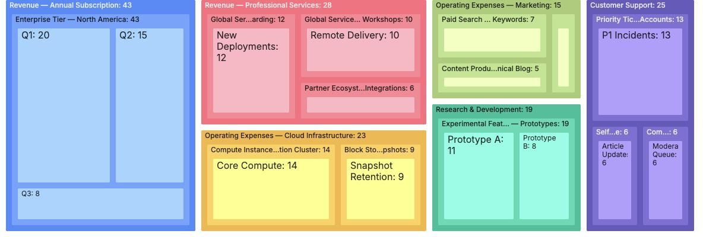
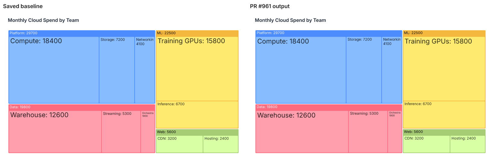
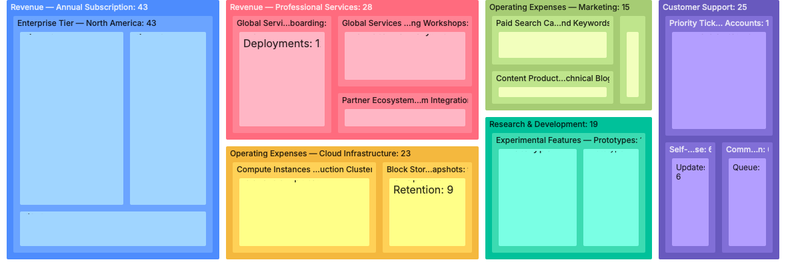
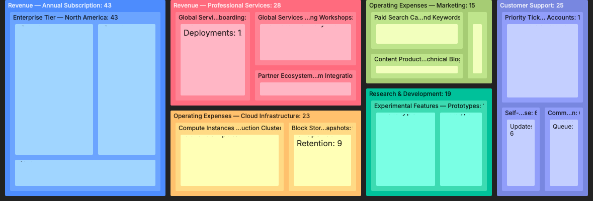
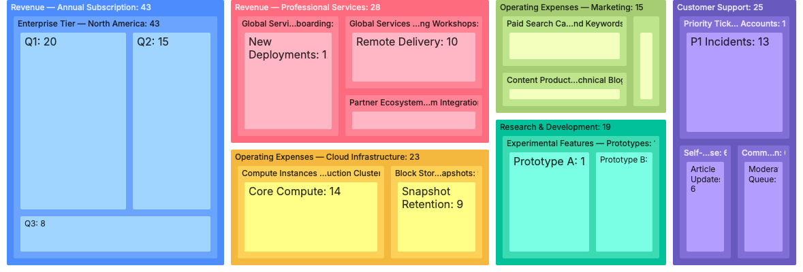
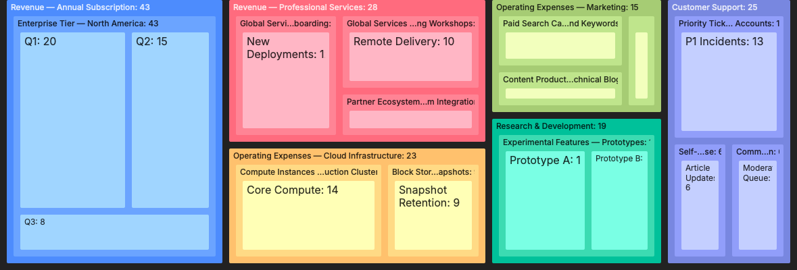

# Treemap label padding and rendering research

Evidence for [Unovis PR #961](https://github.com/f5/unovis/pull/961), collected on 2026-10-21.
This branch holds research artifacts separately from the code PR.

**Latest verification: explicit baseline inheritance on wrapped spans fixes the WebKit clipping. All 6 light/dark tests pass across Chromium, Firefox, and WebKit. See the successful fix follow-up below; the earlier failure is retained as history.**

## Final implementation

- Use `dominant-baseline: text-before-edge` in the shared label style for headers, trimmed labels, and wrapped leaf labels. Explicitly apply `dominant-baseline: inherit` to descendant tspans so WebKit uses the same reference.
- Explicitly position the first wrapped `<tspan>` at `y=0`; subsequent lines retain the existing `1.2em` spacing.
- Remove the intermediate alphabetic-baseline / `dy=1em` workaround.
- Change the default `labelOffsetY` from 4 to 1; leave `labelOffsetX` at 4.
- In Basic, change the explicitly configured Y offset from 6 to 3.
- Preserve full-hierarchy join keys and parent-before-child paint order, including after filtering or sorting.
- Add no text measurements to production rendering. Existing width measurement for wrapping is unchanged. Bounding-box calls are confined to browser regression tests.

The source PR has two commits:

- [`39951ebe`](https://github.com/rokotyan/unovis/commit/39951ebecbcea8d8e349bfc59ed7adf074c1754e): core behavior and its unit/snapshot tests, including explicit span inheritance.
- [`eebfea91`](https://github.com/rokotyan/unovis/commit/eebfea91d8800f8e0a0f7412db24216d4d8c5640): dev example and cross-browser regression coverage.

## Spacing semantics: before and after

Both versions place each label group at `(tile.x0 + labelOffsetX, tile.y0 + labelOffsetY)`.
The baseline determines which font reference is aligned with that position:

| Version | Vertical reference | Default Y offset |
| --- | --- | --- |
| Before this branch | Hanging baseline | 4 |
| Intermediate workaround | Alphabetic baseline shifted by 1em, wrapped leaves only | 4 |
| Final | Upper text edge, shared by all labels | 1 |

The reference is a font metric, not the visible topmost ink pixel. There is no universal integer offset that reproduces every glyph, font, size, and renderer. Reducing Y by 3 matched the sampled Chromium labels closely; one small multiline label differed by one pixel at the bottom in the default comparison. The correction is not a universal browser/font conversion.

Explicit settings override the defaults: existing `labelOffsetY={6}` remains 6. Applications wanting the old sampled spacing should explicitly change 6 to 3. Configured X offsets are unaffected.

`labelOffsetX` also reserves the right inset for fitting/clipping. Label clips use tile width/height minus twice their respective offsets. `tilePaddingTop` reserves space before the child tiles; it does not position the header or establish a separate header clipping boundary. The header has no independent offset setting. A practical header reservation is the Y offset plus rendered header height plus the desired gap, but the visible ink depends on the font.

Reference: [SVG baseline definitions](https://www.w3.org/TR/SVG10/text.html).

## Before this branch versus all final changes

The before capture used the Treemap source files from the exact branch base, `209fbb2f197c595bbac3d8e406aae00db9abe9a2`. The after capture used the complete final source. Both use the same Basic data, light theme, 1400×1000 Chromium viewport, and 1184×400 chart crop. The explicit Y offset was temporarily removed in both captures to demonstrate defaults. The Basic example's X offset remains explicitly 6. The temporary example edits were restored afterward.

Before, default Y=4:


After, default Y=1:



Measured dark-pixel extents, in screenshot coordinates:

| Sample | Before top/bottom | After top/bottom |
| --- | --- | --- |
| Q1 | 53 / 65 | 53 / 65 |
| Core Compute | 273 / 287 | 273 / 287 |
| Prototype A | 229 / 259 | 229 / 259 |
| Article | 242 / 279 | 242 / 278 |
| Enterprise header | 28 / 37 | 28 / 37 |

Measurements threshold screenshot pixels with all RGB channels below 110 within fixed label regions. JPEG antialiasing/encoding can affect these bounds; these are evidence of visual alignment, not a general font-metrics test or pixel-perfect assertion.

## Experiments

1. Keeping `text-before-edge` only on wrapped leaves created inconsistent alignment with hanging headers.
2. Setting Y=0 while leaving X=6 produced asymmetric spacing; hanging headers touched the upper edge.
3. Setting Y=1 in the explicitly configured Basic example was too aggressive relative to its old Y=6 appearance.
4. Y=3 matched sampled wrapped-label top/bottom positions, but hanging headers moved 3px upward.
5. Applying `text-before-edge` to headers as well, keeping Y=3, aligned sampled headers and wrapped labels with the old Y=6 appearance.
6. Setting `tilePaddingTop=0` allowed child tile rectangles to cover most header text; the experiment was restored to 24.

- [Original hanging baseline, Y=6](experiments/old-hanging-offset-six.jpg)
- [Wrapped-only alignment, Y=0](experiments/zero-offset.jpg)
- [Wrapped-only alignment, Y=1](experiments/offset-one.jpg)
- [Wrapped-only alignment, Y=3](experiments/offset-three.jpg)
- [Shared alignment, Y=3, light](experiments/consistent-padding-light.jpg)
- [Shared alignment, Y=3, dark](experiments/consistent-padding-dark.jpg)
- [Zero top tile padding](treemap-samples/zero-tile-padding-top.jpg)

## Sampling the existing dev examples

Existing offsets and component configuration were retained. Sampling used the local-source dev app in Chromium at 1400×1000. Label tops looked consistent on readable tiles. Small tiles can still truncate or clip text; the shared baseline does not make text fit into insufficient space.

| Example | Existing Y offset | Interaction / observation | Screenshot |
| --- | --- | --- | --- |
| SaaS Events | 4 | Dense hierarchy, long labels, narrow leaf tiles | [Image](treemap-samples/saas-events.jpg) |
| Tiling Methods | 6 | Squarify and Binary layouts | [Squarify](treemap-samples/tiling-squarify.jpg), [Binary](treemap-samples/tiling-binary.jpg) |
| Data Update | 6 | Clicked Update Data; item count changed from 34 to 29; labels and parent ordering remained readable | [Image](treemap-samples/data-update.jpg) |
| Huge | 6 | Dense hierarchy; small leaf labels hidden by existing visibility rules | [Image](treemap-samples/huge.jpg) |
| Search | 8 | Varied font sizes; filtered to India; checked dark theme | [Initial](treemap-samples/search.jpg), [Filtered dark](treemap-samples/search-dark-filtered.jpg) |

## Automated validation of the final source

| Check | Result |
| --- | --- |
| `pnpm build:ts` | Pass |
| `pnpm build:dev` | Pass, existing webpack size warnings |
| `pnpm test:ts` | 15 tests, 7 files passed |
| Changed-file ESLint and commit hooks | Pass |
| Focused `generate_treemap` recipe tests after snapshot refresh | 3 passed, 42 unrelated tests skipped; the render test covers both fixtures |
| Repository-wide `pnpm lint` | 24 errors and 355 warnings in untouched dependency/config/generated entrypoints in this isolated checkout |
| Final browser regression spec | 6 passed: Chromium, Firefox, and WebKit, each in light/dark |
| Full final MCP/SSR suite | Not rerun; only the focused Treemap recipe tests were run |

The browser regression spec checks first-line clipping in light/dark themes, header bounds, and the shared computed baseline. It is available to all three configured Playwright projects. The core tests check repeated leaf names in separate parents, identity retention across rerenders, and parent-before-child order after filtering and sorting. Earlier PR evidence includes Chromium/WebKit tests of the superseded `1em` implementation; those results do not verify the final implementation.

Logs: [Core build](logs/core-build.log), [Core tests](logs/core-tests.log), [Dev build](logs/dev-build.log), [Repository lint](logs/repository-lint.log), [Final Treemap SSR tests](logs/treemap-ssr-tests.log), [Snapshot refresh](logs/treemap-ssr-snapshot-update.log).

## SSR findings and snapshot review

The original CI failure was `treemap-two-layer-cloud-costs`: 0.99% differing pixels versus a 0.05% tolerance. That version used the `alphabetic`/`1em` workaround. See [the original failed job](https://github.com/f5/unovis/actions/runs/39501835820/job/119551682159).

A fresh comparison explicitly bound to this worktree's final core build measured 2357 / 387200 differing pixels = 0.608729%, with no rendering warnings, against the old cloud-cost snapshot. The final browser match does not imply an exact SSR match: fonts, sizes, and baseline implementations differ.



- [Original baseline SVG](ssr-final/baseline.svg), [final SVG](ssr-final/actual.svg)
- [Original PNG](ssr-final/baseline.png), [final PNG](ssr-final/actual.png), [pixel diff](ssr-final/diff.png)

The two Treemap snapshots were refreshed to the reviewed final baseline/default semantics. The 6 single-layer and 14 cloud-cost painted tile rectangles have identical attributes before and after; changes concern label positions/alignment and label clipping dimensions. The focused recipe tests then passed without update mode.

An important tooling correction: shared `node_modules` links pointed into another worktree. Earlier exploratory SSR runs therefore did not prove the alternative `text-before-edge` output. Their claimed equivalence to the `1em` workaround is withdrawn. The final comparison and focused tests use explicit aliases for both `@unovis/ts` and `@unovis/ssr` to the intended worktree. Browser screenshots used webpack's local source aliases and were unaffected.

[Comparison script](scripts/compare-ssr.mts). To reproduce, build core, set `UNOVIS_ROOT` to the repository checkout and `UNOVIS_EVIDENCE_DIR` to an output directory, and execute with the MCP package's `tsx`. The supplied tsconfig must explicitly map `@unovis/ts` to that checkout's `packages/ts/dist/index.js` and `@unovis/ssr` to `packages/ssr/src/index.ts`. For focused tests use an equivalent temporary Vitest alias configuration, then run `vitest run -t generate_treemap`; use `UPDATE_IMAGES=1` only to intentionally refresh baselines after review.

## Limits

- Playwright WebKit verification now passes after explicit span inheritance; the installed Safari app was not tested. Chromium and Firefox pass as well.
- Fonts with different ascenders/accents may differ. The chosen 3px compensation is evidence-based for the sampled fonts, not a universal padding equation.
- Arbitrary existing explicit Y offsets are not automatically migrated.
- This note records tests already completed; it does not claim future CI is green.

## WebKit follow-up (final source `9df0e368`)

The user authorized Playwright WebKit in place of the installed Safari app, which was inaccessible while the Mac was locked. These results test Playwright's WebKit build; they do not claim an installed Safari test.

Both existing `treemap-labels.spec.ts` tests fail, in light and dark themes. The first `Q1: 20` line has `getBBox().y = -15.5`, versus the test's minimum -0.5. Visual screenshots confirm missing/clipped first lines. All 12 wrapped first lines have negative top bounds in both themes.

The parent text's computed `dominant-baseline` is `text-before-edge`, but the first tspan resolves to `auto` in WebKit, despite its explicit `y=0`. This narrows the likely cause to baseline handling on wrapped spans; it does not establish a fix. No production code was changed during this test.





[Existing spec output](webkit/tests.log), [per-label computed baselines and bounds](webkit/label-metrics.json). Tests used the final local-source dev server on port 9502, an isolated temporary config selecting only `treemap-labels.spec.ts`, the WebKit project, and a 1400×1000 viewport.

## Successful WebKit fix follow-up

The smallest production change is scoped to Treemap labels:

```css
/* Inside the existing label style */
& tspan {
  dominant-baseline: inherit;
}
```

Without this explicit inheritance WebKit computes the first tspan baseline as `auto`, even when the text parent computes to `text-before-edge`. With it, both compute to `text-before-edge`. The first `Q1` line moves from `getBBox().y=-15.5` to 0. All 12 wrapped first lines are within their clips in light and dark themes. No new measurements, font-specific offsets, or changes to the configured padding are required.

The regression assertion now checks computed baselines on both text parents and every tspan. Firefox serializes the equivalent baseline as `text-top`; the test accepts either spelling and continues to assert actual clipping bounds.

Final checks:

- **6 browser tests pass**, across Chromium, Firefox, and WebKit in light/dark. The initial Firefox launch needed its pinned Playwright browser downloaded; once installed, its clipping checks passed and its computed-name difference was handled in the assertion.
- **15 core tests pass** across 7 files.
- **3 focused Treemap SSR checks pass**, using both reviewed snapshots unchanged by this CSS fix.
- Core/dev builds and changed-file lint pass. Existing repository-wide lint errors remain as previously documented.
- These are Playwright WebKit checks, not a test of the installed Safari app.

WebKit after the fix:





[Firefox light](webkit-fix/firefox-light.png), [Firefox dark](webkit-fix/firefox-dark.png).

Artifacts: [browser test log](webkit-fix/browser-tests.log), [WebKit baseline metrics](webkit-fix/label-metrics.json), [Firefox baseline metrics](webkit-fix/firefox-label-metrics.json), [core tests](webkit-fix/core-tests.log), [SSR tests](webkit-fix/ssr-tests.log), [core build](webkit-fix/core-build.log), [dev build](webkit-fix/dev-build.log).
